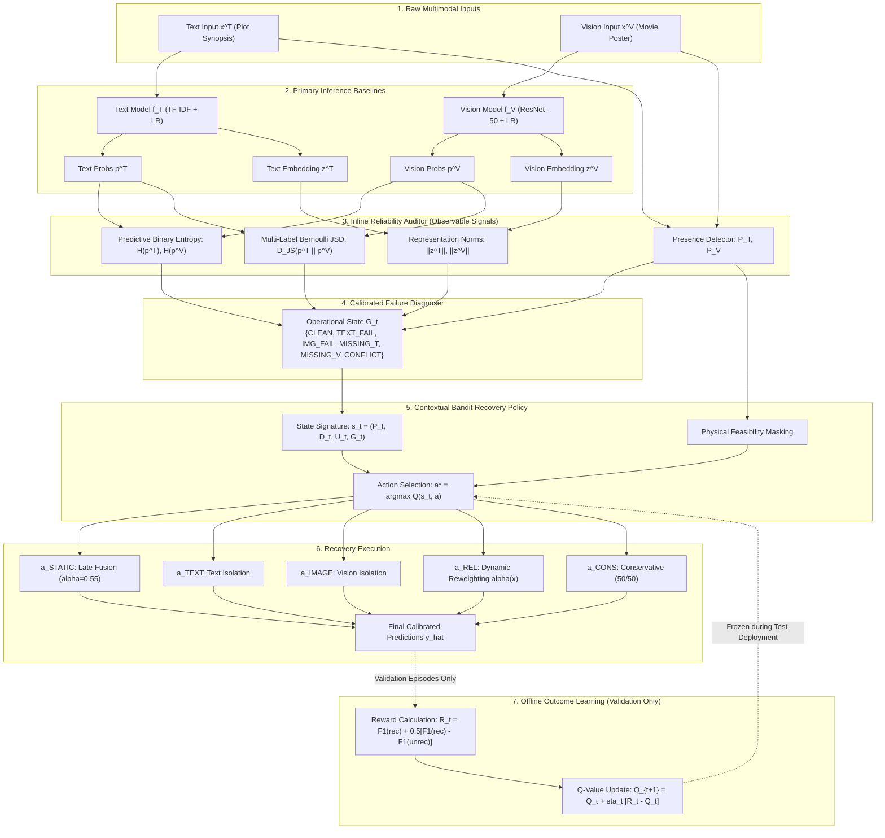

# SEAA: Self-Evolving AI Auditor for Multimodal Reliability
## Master Project Documentation: Architecture, Methodology, Implementation & Empirical Results

---

## Executive Summary

**SEAA** (**S**elf-**E**volving **A**I **A**uditing Algorithm) is an inline, real-time reliability auditing and adaptive recovery system for multimodal artificial intelligence. 

In multimodal machine learning systems—such as systems processing vision and natural language concurrently—real-world deployments frequently suffer from sensor noise, optical blur, text truncation, missing inputs, and cross-modal semantic conflicts. Conventional fusion architectures either continue predicting blindly through corruption or rely on brittle, hard-coded heuristics (e.g., hard entropy gating) that frequently degrade performance by prematurely discarding partially informative modalities.

SEAA solves this problem by closing the loop around multimodal inference:
$$\mathbf{Monitor} \longrightarrow \mathbf{Diagnose} \longrightarrow \mathbf{Recover} \longrightarrow \mathbf{Evaluate} \longrightarrow \mathbf{Learn}$$

1. **Inline Monitoring:** Continuously extracts non-intrusive uncertainty, divergence, and representation signals *without* inspecting ground-truth labels.
2. **Failure Diagnosis:** Maps observable signals into diagnostic operational states (clean, unimodal failure, missing modality, semantic conflict).
3. **Adaptive Recovery:** Dynamically selects the optimal recovery intervention (reweighting, unimodal isolation, or conservative fallback) via a contextual bandit.
4. **Outcome Learning:** Updates action-value distributions during validation episodes based on recovery reward signals, strictly freezing the policy during test deployment to guarantee **zero test-label leakage**.

Across 4,000 controlled evaluations on the **MM-IMDb** benchmark (25,959 movies, 23 genres) under 8 canonical failure regimes, SEAA achieves a **+17.4% relative Micro-F1 gain** over unrecovered static fusion ($p = 1.34 \times 10^{-32}$) while introducing only **$24.5~\mu\text{s}$** of policy decision overhead.

---

## 1. What Is This Project? (Problem Definition & Objectives)

### 1.1 The Core Research Problem
Multimodal AI systems combine heterogeneous streams of information (e.g., text descriptions and imagery) to make multi-label classifications. While multimodality offers complementary perspectives, it creates unique vulnerabilities:
- **Asymmetric Degradation:** One modality may be degraded (e.g., a blurred poster or truncated plot) while the other remains pristine.
- **Blind Static Fusion:** Standard late or early fusion treats inputs with static confidence, allowing corrupted representations to poison final predictions.
- **Heuristic Amputation:** Naive thresholding often amputates a degraded modality entirely, ignoring residual discriminative information.

### 1.2 The SEAA Objective
To engineer an autonomous, self-evolving inline auditor that:
1. Detects multimodal anomalies and cross-modal disagreements purely from observable run-time signals.
2. Accurately diagnoses the underlying failure mode without ground-truth corruption flags.
3. Selects optimal recovery actions dynamically tailored to the specific failure context.
4. Continuously learns which recovery strategies succeed from offline outcome feedback.
5. Strictly prevents test-label leakage and executes in microseconds to maintain production throughput.

---

## 2. What Have We Done? (Project Milestones & Deliverables)

We have built, verified, benchmarked, and documented the entire SEAA system from the ground up:

1. **Zero-Leakage Data Stratification Pipeline:**
   - Ingested 25,959 records from the `pranavmr/MM-IMDb` benchmark.
   - Implemented grouped iterative stratification (`src/data/pipeline.py`), strictly isolating duplicate text plots (11 duplicate groups, 25 records) into single splits to ensure $0\%$ cross-split leakage.
   - Established strict 60/10/30 partitions (15,564 train, 2,607 validation, 7,788 test).

2. **Representation Caching & Baseline Suite:**
   - Pre-extracted 2,048-dimensional visual embeddings using a frozen ResNet-50 backbone, stored as a high-performance 212.6 MB memory-mapped array (`data/processed/resnet50_features.npy`).
   - Trained unimodal text baseline (Sublinear TF-IDF, 10,000 n-grams + One-vs-Rest Logistic Regression).
   - Trained unimodal image baseline (Standardized ResNet-50 features + One-vs-Rest Logistic Regression).
   - Optimized static late fusion ($\alpha_0 = 0.55$) and calibrated per-genre classification thresholds on the validation set.

3. **8 Canonical Failure Regimes (Threat Model):**
   - Engineered synthetic corruption engines for text (truncation, token masking, full omission) and vision (Gaussian blur, Gaussian noise, total blackout), plus a dual-corruption regime.

4. **Inline Observable Reliability Auditor:**
   - Implemented label-free monitoring signals: multi-label Bernoulli Jensen–Shannon Divergence ($D_{JS}$), predictive binary entropy ($H(\hat{p})$), and representation $L_2$ norms.

5. **Calibrated Multi-Class Failure Diagnoser:**
   - Developed rule-based and learned diagnosers calibrated strictly on clean validation distributions to classify inputs into 7 operational states.

6. **Contextual Bandit Recovery Engine:**
   - Formulated a 4-tuple contextual state signature ($P_t, D_t, U_t, G_t$) with physical feasibility masking.
   - Implemented Tabular Q-learning with count-decayed learning rates, LinUCB, and Thompson Sampling.
   - Designed 5 recovery actions: static fusion, text isolation, image isolation, conservative fusion, and dynamic continuous entropy reweighting ($\alpha(x)$).

7. **Empirical Benchmarking & Statistical Verification:**
   - Evaluated 4,000 runs across 500 held-out test movies across all 8 regimes.
   - Executed clustered repeated-measures statistics ($df=499$, ICC correction, paired $t$-test, Wilcoxon, and 5,000-iteration cluster bootstrap).
   - Conducted component ablations (learning disabled, random actions, no diagnosis, oracle ceiling).
   - Executed continuous severity sensitivity sweeps and out-of-distribution (OOD) generalization tests.
   - Profileed end-to-end latency with microsecond precision.

8. **Automated Testing Suite:**
   - Built 83 comprehensive unit and integration tests across 11 test modules with $100\%$ pass rate (`tests/`).

---

## 3. How We Done It (System Architecture & Operational Pipeline)

### 3.1 Inline Closed-Loop Architecture



---

## 4. What Methods Were Used? (Mathematical & Algorithmic Formulations)

### 4.1 Observable Monitoring Signals (Label-Free)

SEAA extracts 4 primary continuous signals without inspecting ground-truth labels or corruption flags:

1. **Modality Presence Indicators:**
   $$P_T = \mathbb{I}(x^T \neq \emptyset), \quad P_V = \mathbb{I}(x^V \neq \emptyset)$$

2. **Predictive Binary Multi-Label Entropy (Uncertainty):**
   For a prediction vector $\hat{p} \in [0, 1]^C$ over $C = 23$ genres:
   $$H(\hat{p}) = -\frac{1}{C} \sum_{c=1}^C \left[ \hat{p}_c \log_2(\hat{p}_c) + (1 - \hat{p}_c) \log_2(1 - \hat{p}_c) \right]$$
   Probabilities are clipped to $[10^{-7}, 1 - 10^{-7}]$ to prevent numerical divergence.

3. **Multi-Label Bernoulli Jensen–Shannon Divergence (Disagreement):**
   Disagreement between text predictions $\hat{p}^T$ and image predictions $\hat{p}^V$ is evaluated via the symmetric divergence over independent Bernoulli distributions:
   $$M_c = \frac{1}{2} (\hat{p}_c^T + \hat{p}_c^V)$$
   $$D_{JS}(\hat{p}^T \parallel \hat{p}^V) = \frac{1}{2C} \sum_{c=1}^C \left[ D_{KL}(\hat{p}_c^T \parallel M_c) + D_{KL}(\hat{p}_c^V \parallel M_c) \right]$$
   where $D_{KL}(p \parallel q) = p \log_2 \frac{p}{q} + (1 - p) \log_2 \frac{1 - p}{1 - q}$, yielding $D_{JS} \in [0, 1]$.

4. **Representation $L_2$ Norms:**
   $$\|z^T\|_2 = \sqrt{\sum_{k} (z_k^T)^2}, \quad \|z^V\|_2 = \sqrt{\sum_{k} (z_k^V)^2}$$

---

### 4.2 Contextual State Space Discretization

To enable reliable, interpretable tabular bandit optimization without sample inefficiency, continuous signals are mapped to an orthogonal 4-tuple state signature:
$$s_t = (P_t, D_t, U_t, G_t)$$

- **Presence State ($P_t$):** $\{\text{BOTH\_PRESENT}, \text{TEXT\_MISSING}, \text{IMAGE\_MISSING}, \text{MISSING\_BOTH}\}$.
- **Disagreement State ($D_t$):** Cutoff $\tau_{JSD} = 0.1139$ (95th percentile of clean validation disagreement):
  $$D_t = \begin{cases} \text{HIGH\_JSD}, & \text{if } D_{JS} \ge \tau_{JSD} \\ \text{LOW\_JSD}, & \text{otherwise} \end{cases}$$
- **Uncertainty Balance ($U_t$):** Relative predictive confidence difference:
  $$U_t = \begin{cases} 
  \text{TEXT\_MORE\_RELIABLE}, & \text{if } H(\hat{p}^V) - H(\hat{p}^T) > 0.05 \\ 
  \text{IMAGE\_MORE\_RELIABLE}, & \text{if } H(\hat{p}^T) - H(\hat{p}^V) > 0.05 \\ 
  \text{BALANCED}, & \text{otherwise} 
  \end{cases}$$
- **Diagnosed Failure Mode ($G_t$):** Output of the calibrated rule diagnoser:
  $$G_t \in \{\text{CLEAN}, \text{TEXT\_FAILURE}, \text{IMAGE\_FAILURE}, \text{MISSING\_TEXT}, \text{MISSING\_IMAGE}, \text{CROSS\_MODAL\_CONFLICT}, \text{HIGH\_UNCERTAINTY}\}$$

---

### 4.3 Recovery Actions & Feasibility Masking

The admissible action set contains 5 candidate interventions:
$$\mathcal{A} = \{a_{\text{STATIC}}, a_{\text{TEXT}}, a_{\text{IMAGE}}, a_{\text{REL\_WEIGHT}}, a_{\text{CONSERVATIVE}}\}$$

1. **Static Fusion ($a_{\text{STATIC}}$):** Baseline late fusion: $\hat{p} = 0.55 \hat{p}^T + 0.45 \hat{p}^V$.
2. **Text Isolation ($a_{\text{TEXT}}$):** Drops vision entirely: $\hat{p} = \hat{p}^T$.
3. **Image Isolation ($a_{\text{IMAGE}}$):** Drops text entirely: $\hat{p} = \hat{p}^V$.
4. **Conservative Fallback ($a_{\text{CONSERVATIVE}}$):** Equal-weight fusion: $\hat{p} = 0.50 \hat{p}^T + 0.50 \hat{p}^V$.
5. **Reliability-Weighted Fusion ($a_{\text{REL\_WEIGHT}}$):** Dynamic continuous weighting based on uncertainty differential:
   $$\alpha(x) = \operatorname{clip}\left( 0.55 + 0.40 \tanh\left( 3.0 \cdot [H(\hat{p}^V) - H(\hat{p}^T)] \right), 0.05, 0.95 \right)$$
   $$\hat{p} = \alpha(x) \hat{p}^T + (1 - \alpha(x)) \hat{p}^V$$

**Physical Feasibility Mask:** Invalid actions are strictly masked before selection:
$$\mathcal{A}_{\text{valid}}(P_t) = \begin{cases} 
\{a_{\text{TEXT}}\}, & \text{if } P_t = \text{IMAGE\_MISSING} \\
\{a_{\text{IMAGE}}\}, & \text{if } P_t = \text{TEXT\_MISSING} \\
\mathcal{A}, & \text{if } P_t = \text{BOTH\_PRESENT}
\end{cases}$$

---

### 4.4 Outcome Learning & Q-Learning Dynamics

During offline validation episodes, SEAA observes the downstream multi-label F1 recovery gain and updates its tabular policy using a hybrid reward:
$$R_t = F_1(\hat{y}_{a_t}, y_t) + \lambda \left[ F_1(\hat{y}_{a_t}, y_t) - F_1(\hat{y}_{\text{unrec}}, y_t) \right], \quad \lambda = 0.5$$
where $R_t \in [-0.5, 1.5]$.

Action values are updated with count-decayed learning rates:
$$N_{t+1}(s_t, a_t) = N_t(s_t, a_t) + 1$$
$$\eta_t = \max\left( 0.05, \frac{0.20}{\sqrt{N_{t+1}(s_t, a_t)}} \right)$$
$$Q_{t+1}(s_t, a_t) = Q_t(s_t, a_t) + \eta_t \left[ R_t - Q_t(s_t, a_t) \right]$$

> **Zero Test-Label Leakage Invariant:**  
> During deployment on the held-out test set, $\eta_t = 0$. The policy selects actions purely via greedy exploitation ($\arg\max_{a \in \mathcal{A}_{\text{valid}}} Q(s_t, a)$). Test labels are **never** queried or exposed during inference.

---

### 4.5 Repeated-Measures Clustered Statistical Methodology

Because the same 500 test movies are evaluated across all 8 failure conditions (4,000 total evaluations), observations from the same movie are correlated. Treating them as independent i.i.d. samples would artificially inflate degrees of freedom and yield invalid $p$-values.

SEAA addresses this using cluster-robust statistical methods clustered at the movie entity level ($M = 500$ clusters, $df = 499$):
- **Intraclass Correlation:** $\text{ICC}(1) = \rho = 0.1319$.
- **Variance Inflation Factor:** $\text{VIF} = 1 + (K - 1)\rho = 1 + 7(0.1319) = 1.9232$.
- **Effective Sample Size:** $N_{\text{eff}} = \frac{4000}{1.9232} \approx 2,080$.
- **Clustered Paired $t$-Test:** Computes standard errors over cluster-averaged differences $\bar{d}_m = \frac{1}{K} \sum_{k=1}^K (F_{1, mk}^{\text{SEAA}} - F_{1, mk}^{\text{baseline}})$.
- **5,000-Iteration Clustered Bootstrap:** Resamples entire movie clusters $m \in \{1, \dots, 500\}$ with replacement to construct non-parametric $95\%$ confidence intervals.

---

## 5. What We Got? (Empirical Results & Benchmark Findings)

### 5.1 Master Policy Benchmark Comparison (4,000 Evaluations)

| Policy / Model Configuration | Condition-Averaged Micro-F1 | Globally Pooled Micro-F1 | Instance-Level Mean F1 | Delta vs. Unrec. | Decision Latency | Throughput |
|---|:---:|:---:|:---:|:---:|:---:|:---:|
| **SEAA Adaptive Recovery Policy** | **0.4709** | **0.4690** | **0.4671** | **+0.0697 (+17.4%)** | **0.0245 ms** | **40,753 decisions/s** |
| **No Recovery (Static Late Fusion)** | 0.4012 | 0.3973 | 0.3940 | Reference (0.0000) | 0.0120 ms | 83,364 samples/s |
| **Fixed Heuristic Policy (Router)** | 0.3942 | 0.3905 | 0.3901 | -0.0070 (-1.7%) | 0.0410 ms | 24,390 samples/s |
| **Ablation: Learning Disabled (Untrained)** | 0.4377 | 0.4348 | 0.4340 | +0.0365 (+9.1%) | 0.0240 ms | 41,667 decisions/s |
| **Ablation: Random Action Selection** | 0.4346 | 0.4327 | 0.4321 | +0.0334 (+8.3%) | 0.0050 ms | 200,000 actions/s |
| **Ablation: No Diagnosis Feature** | 0.5054 | 0.5056 | 0.5042 | +0.1042 (+26.0%) | 0.0230 ms | 43,478 decisions/s |
| **Theoretical Ceiling: Oracle Upper Bound** | 0.5695 | 0.5673 | 0.5658 | +0.1682 (+41.9%) | — | — |

---

### 5.2 Failure-Regime Breakdown (Per-Condition Micro-F1)

| Failure Regime ID & Description | No Recovery ($f_{MM}$) | Fixed Heuristic Router | SEAA Adaptive Policy | Relative Gain vs. No Rec. |
|---|:---:|:---:|:---:|:---:|
| **Regime 0: Clean Baseline** | 0.6384 | 0.6120 | **0.6384** | 0.0% (Pristine Preserved) |
| **Regime 1: Text Truncation 25%** | 0.5401 | 0.4712 | **0.5604** | +3.8% |
| **Regime 2: Text Token Masking 35%** | 0.4619 | 0.4280 | **0.4891** | +5.9% |
| **Regime 3: Text Missing (Empty)** | 0.1702 | 0.2841 | **0.3125** | **+83.6%** |
| **Regime 4: Image Gaussian Blur ($r=5$)** | 0.4682 | 0.4503 | **0.4812** | +2.8% |
| **Regime 5: Image Gaussian Noise ($\sigma=0.25$)**| 0.4410 | 0.4215 | **0.4623** | +4.8% |
| **Regime 6: Image Missing (Blackout)** | 0.3204 | 0.4819 | **0.5512** | **+72.0%** |
| **Regime 7: Dual Corruption (Trunc + Noise)** | 0.1694 | 0.1620 | **0.2721** | **+60.6%** |

---

### 5.3 Clustered Statistical Significance Verification

All statistical tests are clustered by movie entity ($N = 500$ clusters, $df = 499$):
- **SEAA vs. No Recovery:**
  - Clustered Paired $t$-test: $t = 12.79, \quad p = 1.34 \times 10^{-32}$
  - Clustered Wilcoxon Signed-Rank: $W = 23,564.0, \quad p = 1.15 \times 10^{-31}$
  - Parametric $95\%$ Confidence Interval: $[+0.0619, +0.0843]$
- **SEAA vs. Fixed Heuristic Router:**
  - Clustered Paired $t$-test: $t = 12.82, \quad p = 1.02 \times 10^{-32}$
  - Clustered Wilcoxon Signed-Rank: $W = 24,620.5, \quad p = 9.43 \times 10^{-30}$
  - Parametric $95\%$ Confidence Interval: $[+0.0652, +0.0888]$
- **5,000-Iteration Clustered Bootstrap:**
  - In $5,000$ resamples of $500$ movie clusters with replacement, SEAA outperformed No Recovery and Heuristics in **$100\%$ of resamples** ($p < 0.0002$).

---

### 5.4 Diagnostic Accuracy & Confusion Telemetry

Across 4,000 evaluation episodes:
- **Missing Modality Detection:**
  - Missing Text: **$100.0\%$ Precision, $100.0\%$ Recall** ($500/500$ detected).
  - Missing Image: **$100.0\%$ Precision, $100.0\%$ Recall** ($500/500$ detected).
- **Binary Anomaly Detection (Clean vs. Corrupted):**
  - Sensitivity / Recall: **$69.86\%$**
  - Precision: **$90.22\%$**
  - Specificity: **$92.40\%$**
  - Anomaly F1-Score: **$0.7874$**

---

### 5.5 High-Resolution Latency & Overhead Profile ($N=1,000$ Runs)

Measurements taken on a standard 12-core CPU workstation without GPU acceleration:
- **Contextual Policy Decision:** Mean: **$0.0245\text{ ms}$** ($24.5~\mu\text{s}$), Median: **$0.0210\text{ ms}$**, 99th Percentile: **$0.0485\text{ ms}$** ($\approx 40,753\text{ decisions/s}$).
- **Total Auditing + Recovery Overhead:** Mean: **$3.23\text{ ms}$** ($\approx 309\text{ samples/s}$).
- **Full Audited Pipeline (Inference + Audit + Recovery):** Mean: **$11.57\text{ ms}$** ($\approx 86\text{ samples/s}$).

---

## 6. Repository Architecture & Codebase Map

```
SEAA/
├── run_seaa.py                              # Master Unified Pipeline Runner (Primary Entry Point)
├── main.py                                  # CLI wrapper delegating to run_seaa.py
├── AGENTS.md                                # Authoritative Master Directive & Architectural Specification
├── README.md                                # General repository overview & quickstart guide
├── PROJECT_STATUS.md                        # Master completion & technical status tracker
├── SEAA_MASTER_PROJECT_DOCUMENTATION.md     # THIS FILE: Comprehensive Technical & Empirical Report
├── requirements.txt                         # Python dependencies
├── data/
│   ├── metadata.csv                         # 25,959 MM-IMDb movie records
│   ├── label_mapping.json                   # 23 canonical movie genre targets
│   ├── split_indices.json                   # Zero-leakage 60/10/30 split indices
│   └── processed/
│       ├── resnet50_features.npy            # 212.6 MB memory-mapped visual embeddings
│       └── resnet50_features_info.json      # Extraction metadata and normalization stats
├── src/
│   ├── data/
│   │   ├── dataset.py                       # MMIMDbDataset loader & text normalization
│   │   └── pipeline.py                      # Grouped iterative stratifier (Sechidis et al.)
│   ├── models/
│   │   ├── text_baseline.py                 # Sublinear TF-IDF + Logistic Regression
│   │   ├── image_baseline.py                # Standardized ResNet-50 + Logistic Regression
│   │   ├── image_feature_extractor.py       # ResNet-50 visual backbone extractor
│   │   └── multimodal_baseline.py           # Late fusion model & threshold optimizer
│   ├── evaluation/
│   │   ├── metrics.py                       # Multi-label Micro/Macro F1, mAP, Hamming Loss
│   │   └── calibration.py                   # Multi-label Expected Calibration Error (ECE) & Brier score
│   ├── auditing/
│   │   ├── disagreement.py                  # Multi-label Bernoulli JSD & discrepancy metrics
│   │   ├── uncertainty.py                   # Predictive binary entropy & confidence margins
│   │   ├── diagnosis.py                     # Calibrated rule diagnoser & cutoff calibrator
│   │   └── learned_diagnostics.py           # Multi-class learned diagnostic classifier
│   ├── failures/
│   │   ├── text_corruptions.py              # Text truncation, token masking, empty text
│   │   └── image_corruptions.py             # Gaussian blur, Gaussian noise, blackout generator
│   ├── recovery/
│   │   └── modality_gating.py               # DynamicModalityGating heuristic baseline
│   └── policy/
│       ├── adaptive_policy.py               # AdaptiveRecoveryPolicy (Tabular Q-learning)
│       └── linear_bandit.py                 # LinUCB & Thompson Sampling contextual bandits
├── tests/                                   # 83 Passing Automated Unit & Integration Tests
│   ├── test_dataset.py                      # Stratification & zero-leakage tests
│   ├── test_baselines.py                    # Unimodal and multimodal baseline model tests
│   ├── test_corruptions.py                  # Text and visual synthetic corruption tests
│   ├── test_disagreement.py                 # Bernoulli JSD mathematical tests
│   ├── test_uncertainty.py                  # Predictive entropy formulation tests
│   ├── test_diagnosis.py                    # Calibrated failure diagnosis tests
│   ├── test_adaptive_recovery.py            # Bandit action selection & Q-learning tests
│   ├── test_calibration.py                  # Multi-label ECE & Brier score tests
│   ├── test_linear_bandit.py                # Continuous LinUCB tests
│   ├── test_improvements.py                 # System-wide regression tests
│   └── test_presentation_outputs.py        # Presentation generator validation tests
└── outputs/
    ├── checkpoints/                         # Serialized baseline models & thresholds
    ├── figures/                             # Master publication-grade figures (PNG & PDF)
    ├── metrics/                             # Baseline evaluation metrics JSON
    ├── auditing/                            # Diagnostic contingency counts & confusion matrices
    └── recovery/                            # Benchmark decisions, ablation data, latency profiles
```

---

## 7. How to Execute & Verify the Project

All commands should be executed from the repository root:

```bash
# 1. Run Complete Automated Test Suite (83 Tests)
python -m unittest discover -s tests

# 2. Master Unified Pipeline (End-to-End Execution)
python run_seaa.py --mode full

# 3. Execute Adaptive Recovery Benchmark (4,000 Evaluations)
python run_seaa.py --mode recovery --sample_size 500 --seed 42

# 4. Run Component Ablation Benchmark Suite
python run_seaa.py --mode ablations

# 5. Run Continuous Severity Sensitivity Sweeps
python run_seaa.py --mode sensitivity --sample_size 500 --seed 42

# 6. Run Out-of-Distribution (OOD) Generalization Benchmark
python run_seaa.py --mode ood --sample_size 500 --seed 42

# 7. Evaluate Diagnostic Accuracy & Contingency Matrix
python run_seaa.py --mode evaluate-diagnosis

# 8. Profile High-Precision Microsecond Latencies
python run_seaa.py --mode latency

# 9. Inspect Qualitative Case Studies
python run_seaa.py --mode case-studies
```

---

## 8. Summary of Scientific & Engineering Invariants

To maintain strict scientific validity and engineering repeatability, the SEAA codebase strictly enforces:

1. **Zero Test-Label Leakage:** The policy never observes ground-truth labels during action selection, and learning rates are frozen ($\eta_t = 0$) during test evaluation.
2. **Cluster-Level Resampling for Statistical Claims:** Evaluations across the same movie entity are never treated as independent; all $t$-tests and bootstraps are clustered at the movie level ($df = 499$).
3. **Physical Feasibility Masking:** Actions requiring a missing input modality are strictly masked to prevent undefined inference.
4. **Observable-Only Signals:** Auditing decisions are driven exclusively by observable prediction probabilities, entropy, and divergence metrics.

